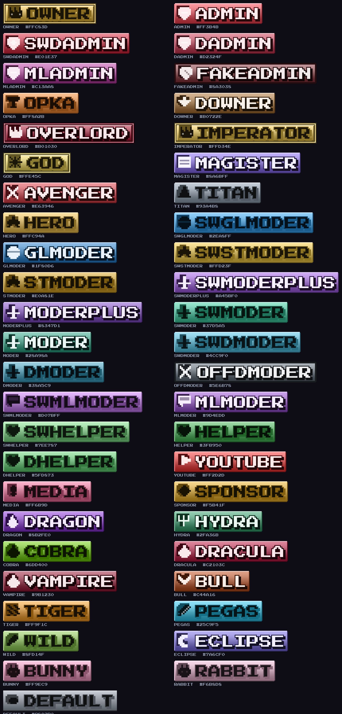
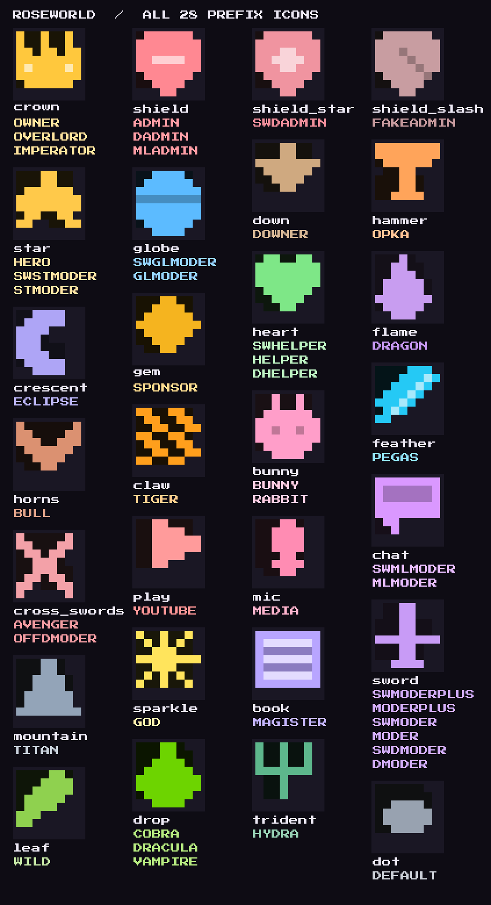

# RoseWorld — префиксы для ролей Minecraft

Готовый набор пиксельных префикс-бейджей для всех 47 ролей сервера **RoseWorld**.
Стиль — ванильный Minecraft: пиксельный шрифт (Press Start 2P), pixel-perfect
рендер без сглаживания, у каждой роли свой цвет, иконка и стиль рамки.





## Что внутри

| Файл | Что это |
|------|---------|
| `roles/<role>.png` | префикс роли, PNG с прозрачным фоном, высота 104 px |
| `catalog.png` | каталог всех префиксов с подписями и HEX-кодами |
| `preview-grid.png` | компактная сетка всех бейджей |
| `roles.json` | все цвета (base / light / dark / text), иконки и веса ролей |
| `icons.png` | лист **всех иконок** крупно: название + роли, где иконка используется |
| `icons/<icon>.png` | каждая иконка отдельным файлом 128×128, прозрачный фон |
| `roseworld-prefixes.zip` | архив со всеми PNG + JSON + этим README |

## Роли и цвета

| # | Роль | HEX | Иконка | Стиль |
|---|------|-----|--------|-------|
| 1 | `owner` | `#FFC83D` | корона | премиум-рамка |
| 2 | `admin` | `#FF3B4B` | щит | обычная |
| 3 | `swdadmin` | `#E01E37` | щит со звездой | обычная |
| 4 | `dadmin` | `#D2324F` | щит | обычная |
| 5 | `mladmin` | `#C13AA8` | щит | обычная |
| 6 | `fakeadmin` | `#8A3038` | перечёркнутый щит | штриховая |
| 7 | `opka` | `#FF8A2B` | молот | обычная |
| 8 | `downer` | `#B0722E` | стрелка вниз | обычная |
| 9 | `overlord` | `#B01030` | корона | премиум-рамка |
| 10 | `imperator` | `#FFD34E` | корона | премиум-рамка |
| 11 | `god` | `#FFE45C` | искра | премиум-рамка |
| 12 | `magister` | `#8A6BFF` | книга | обычная |
| 13 | `avenger` | `#E63946` | скрещённые мечи | обычная |
| 14 | `titan` | `#93A4B8` | гора | обычная |
| 15 | `hero` | `#FFC94A` | звезда | обычная |
| 16 | `swglmoder` | `#2EA8FF` | глобус | обычная |
| 17 | `glmoder` | `#1F80D6` | глобус | обычная |
| 18 | `swstmoder` | `#FFD23F` | звезда | обычная |
| 19 | `stmoder` | `#E0A81E` | звезда | обычная |
| 20 | `swmoderplus` | `#A45BF0` | меч | обычная |
| 21 | `moderplus` | `#8347D1` | меч | обычная |
| 22 | `swmoder` | `#37D5A5` | меч | обычная |
| 23 | `moder` | `#28A98A` | меч | обычная |
| 24 | `swdmoder` | `#4CC9F0` | меч | обычная |
| 25 | `dmoder` | `#38A5C9` | меч | обычная |
| 26 | `offdmoder` | `#5E6B78` | скрещённые мечи | штриховая |
| 27 | `swmlmoder` | `#D07BFF` | чат | обычная |
| 28 | `mlmoder` | `#9D4EDD` | чат | обычная |
| 29 | `swhelper` | `#7EE787` | сердце | обычная |
| 30 | `helper` | `#3FB950` | сердце | обычная |
| 31 | `dhelper` | `#5FD873` | сердце | обычная |
| 32 | `youtube` | `#FF2D2D` | play | обычная |
| 33 | `media` | `#FF6B9D` | микрофон | обычная |
| 34 | `sponsor` | `#F5B41F` | кристалл | обычная |
| 35 | `dragon` | `#8B2FE0` | пламя | обычная |
| 36 | `hydra` | `#2FA36B` | трезубец | обычная |
| 37 | `cobra` | `#6DD400` | капля | обычная |
| 38 | `dracula` | `#C2103C` | капля | обычная |
| 39 | `vampire` | `#9B1230` | капля | обычная |
| 40 | `bull` | `#C44A16` | рога | обычная |
| 41 | `tiger` | `#FF9F1C` | когти | обычная |
| 42 | `pegas` | `#25C9F5` | перо | обычная |
| 43 | `wild` | `#8FD14F` | лист | обычная |
| 44 | `eclipse` | `#7A6CF0` | полумесяц | обычная |
| 45 | `bunny` | `#FF9EC9` | кролик | обычная |
| 46 | `rabbit` | `#F6B8D8` | кролик | обычная |
| 47 | `default` | `#98A2B0` | точка | тонкая |

Цвета подобраны по иерархии: тёплое золото и красный — верхушка (owner/admin),
синий — глобальная администрация, зелёный — модерация хелперов, розовый/фиолетовый —
медиа и особые роли, серый — `default`.

## Как использовать

**Discord / Telegram / VK** — просто загружайте PNG: фон прозрачный, бейдж
растягивается по ширине автоматически.

**На сервере (LuckPerms / чат-плагин)** — префикс задаётся цветом и текстом:

```
/lp group owner meta setprefix "&6&l♛ OWNER &r"
```

Если ставите именно картинку, используйте плагины, поддерживающие image-prefix
(DeluxeMenus, TAB с иконками, ItemsAdder / Oraxen — положите PNG в
`resourcepack/assets/roseworld/textures/prefix/`).

**Иконки отдельно** (`images/prefixes/icons/`) — 28 файлов 128×128 с прозрачным
фоном: подходят для GUI-меню сервера (DeluxeMenus), TAB, ItemsAdder/Oraxen или
как отдельные картинки в Discord.

**В HTML/сайте** — `roles.json` содержит готовые HEX-коды для CSS:

```css
.role-owner { color: #FFC83D; }
```

## Как перегенерировать

```bash
pip install pillow
python3 tools/generate_prefixes.py --scale 4      # собрать всё + zip
python3 tools/generate_prefixes.py --icons-debug  # посмотреть лист иконок
```

Скрипт: `tools/generate_prefixes.py`. Цвета и иконки ролей — в списке `ROLES`,
рисунки иконок — в словаре `ICONS` (8×8, символы `m` тело / `w` блик / `k` тень).
Размер — `SCALE` (целое число, чтобы пиксели оставались ровными).

Шрифт — [Press Start 2P](https://fonts.google.com/specimen/Press+Start+2P),
лицензия SIL OFL 1.1 (`tools/fonts/OFL.txt`).
